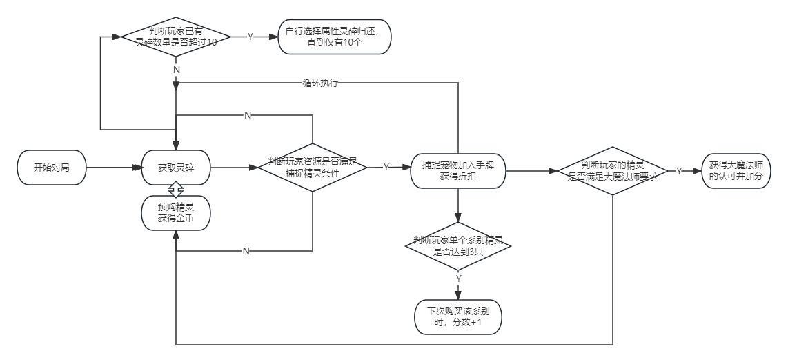

# **洛克王国：魔法宝石** **Roco Kingdom Gem Master**

| 版本 | 改动内容 | 改动日期 |
|------|----------|----------|
| 1.0  | 增加了属性专精的差异化机制，提高了互动性。 | 9/20 |
| 1.0.2 | 将图形界面迁移至 Qt，新增对局平衡模拟工具并更新运行说明。 | 10/7 |
| 1.1 | 增加属性专精的差异化机制，提高互动性。 | 10/8 |
| 1.1.1 | 优化 Qt 卡片显示，新增 Windows 单文件打包脚本和 GitHub Actions 工作流。 | 10/8 |
| 1.1.2 | 加入 EXE 编译功能，修复部分漏洞。 | 10/9 |
| 1.2.0 | 更新水、火、草、萌属性专精名称与效果。 | 10/9 |
| 1.3.0 | 增加10张魔法师卡，满足属性组合自动获得并加3分。 | 10/10 |
| 1.3.1 | 获胜条件调整为20分并支持共同获胜；优化音量控制、界面交互及双属性卡规则说明。 | 10/11 |

## （一）设计目的

《璀璨宝石》是一款以资源规划、引擎构筑与公开市场竞争为核心的策略桌游。玩家通过获取资源、购买发展卡，将一次性的资源逐渐转化为永久折扣，并利用已经形成的资源引擎购买更高阶卡片，最终完成从“积累资源”到“高效转化”的过程。

本项目以《洛克王国》的宠物与属性体系为基础，保留公共资源池＋公开卡池＋引擎构筑的核心结构，并加入单属性 / 双属性宠物、属性专精效果，让不同属性对应不同的策略玩法。

### 一句话概念

> 以洛克王国宠物属性为核心，将《璀璨宝石》的资源引擎构筑转化为“收集宠物、构筑属性、灵活转型”的轻策卡牌游戏。

### 核心体验

玩家通过获取资源、购买宠物、积累属性折扣逐步构建自己的资源体系，并根据公共市场与对手路线灵活调整策略。单属性宠物强化专精，双属性宠物提供路线转换，在有限资源与不断变化的市场中寻找最优发展路径。

### 设计目标

1. 保留《璀璨宝石》的核心策略结构

2. 引入新机制增加决策深度

从线下的游玩发现，传统璀璨宝石中无脑攒高价值牌更容易获胜，受先后手影响较大，因此加入新机制，希望诞生更多决策可能性
单属性宠物强调专精与效率，双属性宠物强调灵活与转型，让玩家在“走深一条路线”和“保留多种可能性”之间产生持续决策。

3. 建立具有属性差异的经济系统

4. 在保留原作体验的基础上形成 IP 独特性

作者很喜欢洛克王国，所以这么干了。

## （二）玩法移植

### 洛克王国用户与IP特征

洛克王国具有较强的**宠物收集、属性认知与养成**特征，用户对宠物属性之间的关系具有天然认知。相比直接加入战斗系统，本项目更希望利用玩家已有的“收集宠物＋属性搭配”认知降低学习成本。

洛克王国玩家一定程度上和桌游玩家（传统宝可梦卡片玩家）重合；宝可梦和璀璨宝石有联动版本。

### 机制映射

| **《璀璨宝石》** | **洛克王国版**                   |
|:-----------------|:--------------------------------|
| 宝石资源         | 五种属性灵碎：水、火、草、萌、恶    |
| 发展卡           | 宠物                             |
| 卡片颜色         | 宠物属性                         |
| 永久折扣         | 宠物提供的属性折扣                |
| 贵族             | 大魔法师                         |
| 公共卡池         | 公共宠物市场                     |
| 资源引擎         | 属性宠物体系                     |
| 金币（万能币）   | 贤者碎晶                         |

## （三）核心玩法

### 游戏流程

**4人对局**，支持单人对 AI 和四 AI 自动对战。

选择模式后创建本局随机种子 → 摆放公共资源、宠物市场和魔法师卡 → 玩家轮流行动 → 结算属性专精与魔法师卡 → 达到20分或市场耗尽后完成本轮，再按轮末分数结算胜负。

### 初始设置

场上共有 **5种属性灵碎：水、火、草、萌、恶**，每种 **7枚**，共35枚。另设 **5枚贤者碎晶**。贤者碎晶属于**万能资源**，可以在购买宠物时替代任意一种属性灵碎。

宠物市场同时展示：

- **1级宠物：5张**

- **2级宠物：5张**

- **3级宠物：5张**

- **魔法师卡：每局先随机公开3张**（满足公开卡的属性条件后自动获得；获得后从剩余牌堆补充）

每位玩家从0资源、0宠物开始。每等级展示比原版多一张，目的是提供更多的策略选择面，提高高价值牌的出现概率。

### 回合流程

**观察市场 → 选择并执行一项行动 → 依次结算因此产生的属性专精 → 检查并发放符合条件的魔法师卡 → 检查结束条件 → 切换玩家并补充市场。**

购买或预购移走市场卡后不会立即补位；市场空位在当前玩家完成全部结算、轮到下一位玩家时补充。若有玩家达到20分，本轮仍继续至最后一名玩家完成行动及相关结算，然后检查胜负；若轮末无人仍有至少20分且市场未耗尽，则继续下一轮。

**玩家行动**

玩家按顺时针顺序行动，每回合只能选择 **1项行动**：

**① 获取资源**

按照传统《璀璨宝石》的规则：

- 从公共资源池拿取 **3种不同属性各1枚**；或

- 从同一种属性拿取 **2枚**，但该属性灵碎在拿取前必须至少剩余4枚。

玩家最多持有 **10枚资源**，贤者碎晶也计入此上限。贤者碎晶不能通过普通“获取资源”行动获得。

**② 捕捉宠物/购买预购宠物**

支付宠物所需灵碎，获得该宠物的**属性折扣与分数**，并结算专精与魔法师卡；市场空位在下一位玩家开始行动前补充。双属性宠物购买时需为每张已拥有的双属性宠物选择本次计入的折扣属性。已经预购的宠物满足购买条件后，仍需消耗一次行动购买。

**③ 预购宠物**

将市场中的1张宠物加入自己的预购区，并从公共池获得 **1枚贤者碎晶**。预购区最多3张；公共池没有贤者碎晶或玩家资源已达上限时不能预购。预购所得贤者碎晶不绑定该卡，可以用于购买任何宠物。

### 核心规则

公共资源有限：5种属性各7枚，所有玩家共享。

永久折扣：每获得1只某属性宠物，之后购买该属性宠物时永久减少对应属性的资源需求。

市场公开：最多展示15张宠物和3张魔法师卡，玩家可以据此规划路线；宠物卡牌堆耗尽后对应等级不再补牌，魔法师卡获得后由剩余牌堆补充，牌堆耗尽则留空。

资源上限：每位玩家最多持有10枚资源，普通属性灵碎、贤者碎晶和临时贤者碎晶均计入上限。

满足本局公开的魔法师卡属性需求即可获得额外分数；具体获取检查时机、属性计数方式与10张卡的条件见下方“魔法师卡”规则。

### 胜利条件

任一玩家在行动及相关结算后达到 **20分**时，触发本轮结束条件；本轮剩余玩家仍各完成一次行动及相关结算。胜负只在整轮结束后结算：轮末仍有至少20分的玩家才有获胜资格，**达标玩家中分数最高者获胜**；若并列，则共同获胜。若轮末无人达到20分且公共市场未耗尽，则清除本轮结束标记并继续游戏；若1、2、3级公共市场同时为空，则本轮结束后结束对局，但无人达到20分时本局无人获胜。

### <u>特殊机制</u>

- **<u>魔法师卡</u>**

游戏共有以下10种魔法师卡，每局先随机公开其中3张，其余组成牌堆；每张固定提供3分，不需要购买。玩家完成行动及所有待结算专精后，系统从公开区左到右检查：只统计该玩家已购买宠物的属性，双属性宠物的两个属性分别计数，资源和预购宠物不计入。每回合至多获得一张符合条件的卡；获得后从牌堆补入公开区，新补入的卡不会在同一次检查中连锁发放。牌堆耗尽后不再补充。

| 魔法师 | 属性需求 | 得分 |
|:---|:---|---:|
| 萌萌 | 萌4＋草4 | 3 |
| 格里芬 | 火4＋水4 | 3 |
| 伊里斯 | 水3＋恶3＋草3 | 3 |
| 皮卡 | 火4＋萌4 | 3 |
| 万事通 | 草3＋恶3＋水3 | 3 |
| 博得 | 水4＋草4 | 3 |
| 路易斯 | 火3＋恶3＋萌3 | 3 |
| 恩佐 | 恶4＋萌4 | 3 |
| 兰斯洛 | 水3＋火3＋草3 | 3 |
| 斯诺克 | 草3＋萌3＋恶3 | 3 |

- **<u>属性专精</u>**

<u>同一属性的单属性已购宠物达到2张时，触发第1次阶段一；达到3张时，触发第1次阶段二。之后每增加3张重复触发：5/6张分别触发第2次阶段一/二，8/9张分别触发第3次阶段一/二，以此类推。双属性宠物不计入任何属性专精数量。通过恶系阶段二夺来的单属性宠物也计入专精；由此产生的新专精会在夺卡后、当前回合结束前结算。</u>

专精在触发它的行动后立即结算，全部专精效果结算完才进入回合结束流程。例如，水系阶段二获得的免费购买效果会保留到该玩家之后下一次购买时使用。

|  |  |  |
|:---|:---|:---|
| <u>系别</u> | <u>特性 阶段一</u> | <u>特性 阶段二</u> |
| <u>水</u> | {泡沫幻影}选择一张公共市场宠物，将其最高的一项成本减少1；若并列最高则随机选一项 | {免费捕捉}下一次购买免费 |
| <u>火</u> | {引燃}随机选择一名有预购卡或已购卡的对手；若其有预购卡，随机引燃一张并归还至对应等级牌库，预购所得贤者碎晶保留；否则引燃其最低等级的一张已购卡并扣除对应分数。若所有对手都没有可引燃的卡，播报效果未生效。对手的攻击免疫可以抵挡此次引燃 | {阳火增辉}下一张购买的宠物分数翻倍 |
| <u>草</u> | {根吸收}选择一张公共市场宠物，使其分数永久+1 | {汲取}获得等同于全部玩家已购买的单属性草系宠物数量之和的临时贤者碎晶；购买时优先消耗，且不会进入或归还公共池 |
| <u>萌</u> | {撒娇}获得一次攻击免疫，下次遭受其他玩家攻击时免疫该次攻击，包括甜心续航对自己的效果 | {甜心续航}对每名未免疫的对手，优先从未被萌化的3级已购宠物中随机选择一张；没有可选3级卡时，再从未被萌化的2级卡中随机选择。1级卡不能被萌化；正分卡分数归零并标记为已萌化，原本0分的卡不改变也不标记。两级都没有可选卡时，会在行动记录和本局日志中说明 |
| <u>恶</u> | {吞噬}在自己资源未满时，选择一名有属性灵碎的对手，随机偷取其1枚属性灵碎；没有合法目标或攻击被免疫时效果不生效 | {恶魔契约}选择一名有已购宠物的对手，随机夺取其一张已购宠物，分数随卡转移；攻击免疫可以抵挡。困难 AI 优先选择未处于攻击免疫的合格对手中当前分数最高者；若所有合格对手均免疫，则选择当前分数最高者，攻击会被免疫。夺来的单属性宠物计入专精门槛，新专精会在本回合结束前结算 |

- **<u>双属性宠物</u>**

双属性宠物同时具有两种属性，但不会同时提供两种折扣。购买双属性宠物时，玩家需要为自己已拥有的每张双属性宠物选择本次计入的一个属性折扣；每次购买都可以重新选择。自己的回合中，也可以把已购买的双属性宠物卡拖动到它的任一属性栏，调整当前折扣属性。双属性宠物本身不计入单属性专精数量。

<u>例如：</u>

> **<u>火/萌宠物 → 可选择获得「火」或「萌」永久折扣</u>**

## （四）界面设计

当前客户端为 Qt6 桌面界面。标题页选择单人难度或四 AI 对战后开始本局；随机模式在选择模式后生成随机局编号，并使用操作系统随机源，编号不能用于推算或复现随机结果；需要复现时可使用固定种子。对局界面包含公共资源、三级公共市场、预购区、行动记录和四名玩家状态栏。玩家状态栏默认显示名称与分数，悬停显示资源、贤者碎晶、魔法师卡、当前效果和已购宠物。卡面及对局播报显示宠物名称，卡号只作为内部数据标识。对局右上角“设置”提供规则速查、独立背景音乐与音效音量调节，以及退出到标题。

单人模式的简单 AI 名称为米米、米莎、米蒂；困难 AI 名称为可丽希亚、菲尔特、卡普。四 AI 对战使用 AI-1 至 AI-4。

## （五）数值设计

### 卡池结构

沿用《璀璨宝石》的 **90张、三级卡池**结构：一级40张、二级30张、三级20张；单属性60张、双属性30张。每级公共市场最多展示5张。现行卡片名称、属性、成本和分数以项目内 [卡片.md](./卡片.md) 为准，避免在两份文档中重复维护卡片数据。

| **等级** | **总卡数** | **单属性** | **双属性** | **双属性比例** |
|:---------|-----------:|-----------:|-----------:|---------------:|
| 一级     |         40 |         25 |         15 |          37.5% |
| 二级     |         30 |         19 |         11 |          36.7% |
| 三级     |         20 |         16 |          4 |            20% |
| **合计** |     **90** |     **60** |     **30** |      **33.3%** |

一级、二级承担主要的**引擎构筑与路线连接**，因此提高双属性比例；三级降低双属性比例，避免后期过度依赖灵活折扣，获得高分的同时更好地得到魔法师牌。

### 属性分布

五种属性为：**水 / 火 / 草 / 萌 / 恶**

现有7种双属性组合为游戏中实际存在的7种组合：

**水火、水草、水恶、火草、火萌、火恶、草萌**

### 卡片成长曲线

卡片等级对应不同的资源投入和收益：

| **等级** | **主要功能** | **分数** | **设计目的**         |
|:---------|:-------------|:---------|:---------------------|
| 一级     | 建立属性折扣 | 0～1     | 快速建立引擎         |
| 二级     | 扩展、转型   | 1～3     | 提高资源转化效率     |
| 三级     | 终局兑现     | 3～5     | 将前期引擎转化为分数 |

整体形成：

**低成本建立引擎 → 中期扩大优势 → 高成本兑现分数**

### 单属性与双属性的数值关系

双属性的优势是**选择权**，因此不能简单等同于两个单属性折扣。

**单属性宠物：**

> 固定提供1种属性折扣  
> → 成本较低  
> → 路线明确  
> → 专精效率高

**双属性宠物：**

> 两种属性二选一提供1点折扣  
> → 成本略高  
> → 路线更加灵活  
> → 适合转型与补缺口

通过**灵活性换取成本**，避免双属性宠物成为“看到就必买”的最优解。

### 平衡目标

数值验证主要关注三个指标：

**① 属性平衡**

控制五种属性在整个卡池中的实际出现频率，避免火因双属性连接度过高而形成绝对优势。

**② 单双属性平衡**

单属性强调效率，双属性强调选择权，使两者对应不同策略，而不是简单的强弱关系。

**③ 等级节奏**

设计目标是让玩家在前期建立基础引擎、中期感受到路线差异、后期通过三级卡兑现资源；**15～20分钟是目标时长，尚非实测保证**。

最终希望形成：

> **一级决定“我要走哪条路”，二级决定“我要不要转路”，三级决定“前面的规划能兑现多少”。**

**以下卡片明细为早期设计稿，已不作为当前游戏卡池数据。**现行数据请查阅 [卡片.md](./卡片.md)。

**历史数值草案（保留供设计参考）**

以下表格保留了早期卡片编号、费用和分数记录；与现行卡片清单不一致时，以 `卡片.md` 和游戏实现为准。

**一级卡**

| **编号** | **属性** | **成本**      | **分数** |
|:---------|:---------|:--------------|:---------|
| S01      | 水       | 火2＋草2      |        0 |
| S02      | 水       | 火2＋萌2      |        0 |
| S03      | 水       | 水2＋恶2      |        0 |
| S04      | 水       | 火1＋草1＋萌2 |        1 |
| S05      | 水       | 火1＋恶1＋草2 |        0 |
| S06      | 火       | 水2＋草2      |        0 |
| S07      | 火       | 水2＋恶2      |        0 |
| S08      | 火       | 草2＋萌2      |        0 |
| S09      | 火       | 水1＋草1＋恶2 |        1 |
| S10      | 火       | 水1＋萌1＋草2 |        0 |
| S11      | 草       | 水2＋火2      |        0 |
| S12      | 草       | 草2＋萌2      |        0 |
| S13      | 草       | 火2＋恶2      |        0 |
| S14      | 草       | 水1＋火1＋萌2 |        1 |
| S15      | 草       | 火1＋恶1＋水2 |        0 |
| S16      | 萌       | 火2＋草2      |        0 |
| S17      | 萌       | 火2＋水2      |        0 |
| S18      | 萌       | 萌2＋恶2      |        0 |
| S19      | 萌       | 火1＋草1＋水2 |        1 |
| S20      | 萌       | 火1＋恶1＋草2 |        0 |
| S21      | 恶       | 水2＋火2      |        0 |
| S22      | 恶       | 水2＋萌2      |        0 |
| S23      | 恶       | 火2＋恶2      |        0 |
| S24      | 恶       | 水1＋火1＋萌2 |        1 |
| S25      | 恶       | 火1＋草1＋水2 |        0 |
| D01      | 水＋火   | 草2＋萌2      |        0 |
| D02      | 水＋火   | 草1＋恶1＋萌2 |        0 |
| D03      | 水＋草   | 火2＋恶2      |        0 |
| D04      | 水＋草   | 火1＋萌1＋恶2 |        0 |
| D05      | 水＋草   | 火2＋萌1＋恶1 |        1 |
| D06      | 水＋恶   | 火2＋草2      |        0 |
| D07      | 水＋恶   | 火1＋草1＋萌2 |        1 |
| D08      | 火＋草   | 水2＋萌2      |        0 |
| D09      | 火＋草   | 水1＋恶1＋萌2 |        0 |
| D10      | 火＋萌   | 萌2＋恶2      |        0 |
| D11      | 火＋萌   | 草1＋水1＋恶2 |        0 |
| D12      | 火＋恶   | 水2＋萌2      |        0 |
| D13      | 火＋恶   | 水1＋草1＋萌2 |        1 |
| D14      | 草＋萌   | 火2＋水2      |        0 |
| D15      | 草＋萌   | 火1＋水1＋恶2 |        0 |

**二级卡**

| **编号** | **属性** | **成本**         | **分数** |
|:---------|:---------|:-----------------|:---------|
| S26      | 水       | 火3＋草2         |        1 |
| S27      | 水       | 火2＋萌2＋恶1    |        1 |
| S28      | 水       | 草3＋恶2         |        2 |
| S29      | 水       | 火2＋草2＋萌2    |        2 |
| S30      | 火       | 水3＋草2         |        1 |
| S31      | 火       | 水2＋恶2＋萌1    |        1 |
| S32      | 火       | 草3＋萌2         |        2 |
| S33      | 火       | 水2＋草2＋恶2    |        3 |
| S34      | 草       | 水3＋火2         |        1 |
| S35      | 草       | 水2＋萌2＋恶1    |        1 |
| S36      | 草       | 火3＋恶2         |        2 |
| S37      | 草       | 水2＋火2＋萌2    |        2 |
| S38      | 萌       | 火3＋草2         |        1 |
| S39      | 萌       | 火2＋水2＋恶1    |        1 |
| S40      | 萌       | 草3＋恶2         |        2 |
| S41      | 萌       | 火2＋草2＋水2    |        3 |
| S42      | 恶       | 水3＋火2         |        1 |
| S43      | 恶       | 水2＋萌2＋草1    |        2 |
| S44      | 恶       | 火3＋草2         |        3 |
| D16      | 水＋火   | 草3＋萌2         |        1 |
| D17      | 水＋火   | 草2＋恶2＋萌1    |        2 |
| D18      | 水＋草   | 火3＋恶2         |        1 |
| D19      | 水＋草   | 火2＋萌2＋恶1    |        2 |
| D20      | 水＋恶   | 火3＋草2         |        1 |
| D21      | 火＋草   | 水3＋萌2         |        1 |
| D22      | 火＋草   | 水2＋恶2＋萌1    |        2 |
| D23      | 火＋萌   | 草3＋恶2         |        1 |
| D24      | 火＋萌   | 草2＋水2＋恶1    |        2 |
| D25      | 火＋恶   | 水3＋草2         |        2 |
| D26      | 草＋萌   | 火3＋水2         |        1 |

**三级卡**

| **编号** | **属性** | **成本**               | **分数** |
|:-------|:---------|:-----------------------|:---------|
| S45    | 水           | 水3＋火7               |        5 |
| S46    | 萌           | 萌3＋恶7               |        5 |
| S47    | 火           | 火3＋草7               |        5 |
| S48    | 草           | 草3＋水7               |        5 |
| S49    | 恶           | 恶3＋火7               |        5 |
| S50    | 水           | 火7                    |        4 |
| S51    | 恶           | 草7                    |        4 |
| S52    | 萌           | 火7                    |        4 |
| S53    | 水           | **水6＋火3＋草3**      |        4 |
| S54    | 恶           | **恶6＋火3＋萌3**      |        4 |
| S55    | 火           | **火6＋水3＋恶3**      |        4 |
| S56    | 草           | **草6＋水3＋萌3**      |        4 |
| S57    | 萌           | **萌6＋火3＋草3**      |        4 |
| S58    | 恶           | **萌3＋火3＋草3＋恶5** |        3 |
| S59    | 萌           | **火3＋恶3＋草3＋萌5** |        3 |
| S60    | 草           | **萌3＋水3＋火3＋草5** |        3 |
| D27    | 水＋恶       | 草6＋萌3＋恶3          |        4 |
| D28    | 火＋萌       | 水6＋萌3＋恶3          |        4 |
| D29    | 草＋萌       | 萌3＋水7               |        5 |
| D30    | 火＋恶       | 恶3＋草7               |        5 |

| **模板**   | **数量** | **分数** | **战略定位**     |
|:-----------|:---------|:---------|:-----------------|
| **73**     |    **5** |        5 | 专精路线高分兑现 |
| **7**      |    **3** |        4 | 非专精极端高价值 |
| **633**    |    **5** |        4 | **专精雪球兑现** |
| **3335**   |    **3** |        3 | 多属性折扣兑现   |
| **双属性** |    **4** |      4–5 | 高阶转型         |
| **合计**   |   **20** |          |                  |

## （六）美术设计

当前美术与界面颜色由 `src/theme.py` 统一管理；资源图标、属性图标、字体和音效等随项目资源打包。本文原有美术构想不代表已实现内容。

## （七）互动

以下为后续规划，当前版本尚未实现：

1. 表情包交互：快一点、生气、阴阳怪气、祝你好运、咧嘴笑。

2. 局内规则快查：为玩家提供快速查看规则的入口。

## （八）新手引导

新手引导目前尚未实现。早期构想为首次启动时提供“熟悉璀璨宝石”和“第一次游玩”两种入口，并分区介绍卡片、资源和行动规则。
