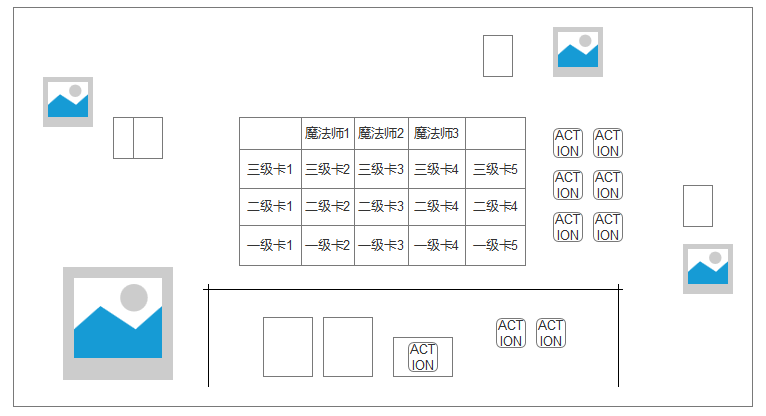

**洛克王国：魔法宝石**

|      |                                            |          |
|------|--------------------------------------------|----------|
| 版本 | 改动内容                                   | 改动日期 |
| 1.1  | 增加了属性专精的差异化机制，提高了互动性。 | 9/20     |
| 1.2  | 更新水、火、草、萌属性专精名称与效果。     | 10/7     |
| 1.3  | 增加10张魔法师卡，满足属性组合自动获得并加3分。 | 10/7     |

# （一）设计目的

《璀璨宝石》是一款以**资源规划、引擎构筑与公开市场竞争**为核心的策略桌游。玩家通过获取资源、购买发展卡，将一次性的资源逐渐转化为永久折扣，并利用已经形成的资源引擎购买更高阶卡牌，最终完成从“积累资源”到“高效转化”的过程。

本项目以《洛克王国》的宠物与属性体系为基础进行手游化改造，保留公共资源池＋公开卡池＋引擎构筑的核心结构，并加入单属性 / 双属性宠物、属性专精与属性特色效果，让不同属性对应不同的策略玩法。最终希望形成一套**15～20分钟完成一局、低操作负担但具有较强策略深度**的独立策略玩法。

### 一句话概念

> **以洛克王国宠物属性为核心，将《璀璨宝石》的资源引擎构筑转化为“收集宠物、构筑属性、灵活转型”的轻量策略玩法。**

### 核心体验

### 玩家通过获取资源、购买宠物、积累属性折扣逐步构建自己的资源体系，并根据公共市场与对手路线灵活调整策略。单属性宠物强化专精，双属性宠物提供路线转换，在有限资源与不断变化的市场中寻找最优发展路径。

### 设计目标

**1. 保留《璀璨宝石》的核心策略结构**

**2. 引入特殊机制增加决策深度**

通过洛克王国的属性体系建立属性之间的连接网络。单属性宠物强调**专精与效率**，双属性宠物强调**灵活与转型**，让玩家在“走深一条路线”和“保留多种可能性”之间产生持续决策。

**3. 建立具有属性差异的经济系统**

五种属性并非完全对称，而是通过不同的双属性组合形成属性网络。其中火属性具有较高的连接度，因此通过**卡牌等级分布、双属性比例与资源费用**控制其经济渗透率，使其成为具有战略价值的枢纽。

**4. 在保留原作体验的基础上形成 IP 独特性**

不以简单的“换皮”为目标，而是让洛克王国的**宠物收集与属性关系**真正参与核心机制设计，使 IP 元素成为影响玩家决策的系统性内容。

**~~5.提高玩家黏性，让该内嵌游戏成为玩家日活的一部分。~~**

# （二）玩法移植

### 洛克王国用户与IP特征

洛克王国具有较强的**宠物收集、属性认知与养成**特征，用户对宠物属性之间的关系具有天然认知。相比直接加入战斗系统，本项目更希望利用玩家已有的“收集宠物＋属性搭配”认知降低学习成本。

洛克王国玩家一定程度上和桌游玩家（传统宝可梦卡牌玩家）重合；宝可梦和璀璨宝石有联动版本。

### 机制映射

| **《璀璨宝石》** | **洛克王国版**                   |
|:-----------------|:---------------------------------|
| 宝石资源         | 五种属性灵碎：水、火、草、萌、恶 |
| 发展卡           | 宠物                             |
| 卡牌颜色         | 宠物属性                         |
| 永久折扣         | 宠物提供的属性折扣               |
| 贵族             | 高级魔法师                       |
| 公共卡池         | 公共宠物市场                     |
| 资源引擎         | 属性宠物体系                     |
| 金币（万能币）   | 贤者碎晶                         |

其中最大的机制变化是加入**双属性宠物**：购买后可以在其两个属性中选择一种作为折扣，使其成为连接不同属性路线的“枢纽”。

# （三）核心玩法

### **游戏流程**

**4人对局**。  
进入对局 → 摆放公共资源与宠物市场 → 玩家轮流行动 → 建立属性折扣 → 购买高阶宠物 → 达到18分 → 立即结算。

### **初始设置**

场上共有 **5种属性灵碎：水、火、草、萌、恶**，每种 **7枚**，共35枚。另设 **5枚贤者碎晶**。贤者碎晶属于**万能资源**，可以在购买宠物时替代任意一种属性灵碎。

宠物市场同时展示：

- **1级宠物：5张**

- **2级宠物：5张**

- **3级宠物：5张**

- **魔法师卡：10张**（每次从牌堆公开3张，满足公开卡的属性条件后自动获得）

每位玩家从0资源、0宠物开始。每等级展示比原版多一张，目的是提供更多的策略选择面，提高高价值牌的出现概率。

### **回合流程**

**观察市场 → 选择行动 → 执行动作 → 补充市场 → 检查结束条件**

**玩家行动**

玩家按顺时针顺序行动，每回合只能选择 **1项行动**：

**① 获取资源**

按照传统《璀璨宝石》的规则：

- 从公共资源池拿取 **3种不同属性各1枚**；或

- 从同一种属性拿取 **2枚**，但该属性灵碎在拿取前必须至少剩余4枚。

玩家最多持有 **10枚灵碎**。贤者碎晶不能通过普通“获取资源”行动获得。

**② 捕捉宠物/购买预购宠物**

支付宠物所需灵碎，获得该宠物的**属性折扣与分数**，随后从对应等级牌堆补充一张新宠物。灵碎归还至公共区；已经预购的宠物，当满足购买要求时，需要消耗一个回合购买。

**③ 预购宠物**

将市场中的1张宠物加入自己的保留区，并获得 **1枚贤者碎晶**。保留区最多3张宠物。因预购获得的贤者碎晶并非必须用于购买预购宠物，可以灵活使用。

### **核心规则**

公共资源有限：5种属性各7枚，所有玩家共享。

永久折扣：每获得1只某属性宠物，之后购买该属性宠物时永久减少对应属性的资源需求。

市场公开：15张宠物和当前公开的3张魔法师卡始终可见，玩家可以据此规划路线。

资源上限：每位玩家最多持有10枚灵碎。

满足魔法师卡的属性需求即可获得额外分数；具体获取检查时机、属性计数方式与10张卡的条件见下方“魔法师卡”规则。

### **胜利条件**

任一玩家累计达到 **18分**时，对局立即结束，**分数最高者获胜**。若公共市场全部耗尽，则完成当前轮次后结算。

### <u>特殊机制</u>

- **<u>魔法师卡</u>**

全局共有以下10张魔法师卡，每张固定提供3分，不需要购买。开局随机公开3张，其余组成魔法师牌堆。每次玩家完成回合操作后（包含该回合待结算的专精效果全部结算后），只检查当前公开的魔法师卡；按该玩家已购买宠物的属性计数，双属性宠物的两个属性分别计数，资源和预购宠物不计入。满足公开卡条件时自动获得该卡并加3分，随后由牌堆补位。每张卡全局只能获得一次，同一玩家可获得多张；一次检查同时满足多张公开卡时全部获得。刚补入市场的卡从下一次回合结算开始检查，不在本次检查中连锁获得。

| 魔法师 | 属性需求 | 得分 |
|:---|:---|---:|
| 萌萌 | 萌4＋草4 | 3 |
| 格里芬 | 火4＋水4 | 3 |
| 伊里斯 | 水3＋恶3＋草3 | 3 |
| 皮卡 | 火4＋萌4 | 3 |
| 万事通 | 草3＋恶3＋水3 | 3 |
| 博得 | 水4＋草4 | 3 |
| 路易斯 | 火3＋恶3＋萌3 | 3 |
| 恩佐 | 恶4＋萌4 | 3 |
| 兰斯洛 | 水3＋火3＋草3 | 3 |
| 斯诺克 | 草3＋萌3＋恶3 | 3 |

- **<u>属性专精</u>**

<u>当玩家每拥有 **【2】** 张同一属性的宠物时，触发一次对应属性的专精效果； **【3】** 张时触发阶段二。双属性宠物不计入任何属性专精数量。每次专精效果独立触发并消耗，具体数值以游戏平衡测试结果为准。</u>

专精效果在玩家行动结束后生效。例如，玩家在第X回合购买第3张水系宠物时，第X+1回合开始的第一个购买行为免费。

|  |  |  |
|:---|:---|:---|
| <u>系别</u> | <u>特性 阶段一</u> | <u>特性 阶段二</u> |
| <u>水</u> | {泡沫幻影}选择公共市场中的一张宠物卡，将其成本中最高的一种资源成本-1，如果几项成本都相同则随机选择一种-1 | 下一次购买行为免费 |
| <u>火</u> | {引燃}随机选择一名其他玩家；若其有预购卡，随机烧掉一张并归还至对应等级牌库，预购获得的贤者碎晶保留；若其没有预购，则随机烧掉其最低等级的一张已购卡并扣除对应分数 | {阳火增辉}下一张购买的卡片分数翻倍 |
| <u>草</u> | {根吸收}选择公共市场中的一张宠物卡，使其购买后获得的分数+1 | {汲取}获得其他玩家手牌数量中草系数量之和+1枚临时贤者碎晶；使用后消耗，不归还市场 |
| <u>萌</u> | {撒娇}获得一次攻击免疫，在下一次遭受其他玩家攻击时免疫并消耗该效果 | {甜心续航}每名其他玩家各随机选择一张已购二级或三级卡，萌化为同属性低一级模板并降低分数 |
| <u>恶</u> | {吞噬}选择一名其他玩家，随机从其当前持有的灵碎中偷取 **1枚**。 | {恶魔契约}对于场上手牌数量最多的玩家，随机偷走一张已购买的手牌 |

- **<u>双属性宠物</u>**

<u>双属性宠物同时具有两种属性，但不会同时提供两种折扣。购买后，该宠物提供**可以临时决定**的**两个属性二选一的折扣**。这个选择在购买时产生。每次购买时问询。</u>

<u>例如：</u>

> **<u>火/萌宠物 → 可选择获得「火」或「萌」永久折扣</u>**

- **<u>随机事件：大量出没（待定）</u>**

第八回合与第十五回合开始时触发“大量出没”，在卡池的左侧生成四张随机折扣宠物牌，由逆时针顺序进行购买。折扣规则：半价向上取整。如2-2变成1-1，1-1-2变成1-1-1，2-2变成1-1，3-2变成2-1，2-2-1变成1-1-1，3-7变成2-4，3-3-3-5变成2-2-2-3。玩家可以跳过购买，不能预购。所有玩家完成购买或者跳过动作时，大量出没结束。正式开始第八回合。

# （四）界面设计

# 

界面说明：

中间为资源展示区；显示四个玩家或人机头像；每个玩家已获得的资源公示；预购的宠物横置，并将获得的金币放在上面。

# （五）数值设计

### 卡池结构

沿用《璀璨宝石》的 **90张、三级卡池**结构，同时通过双属性卡重新分配策略密度。

| **等级** | **总卡数** | **单属性** | **双属性** | **双属性比例** |
|:---------|-----------:|-----------:|-----------:|---------------:|
| 一级     |         40 |         25 |         15 |          37.5% |
| 二级     |         30 |         19 |         11 |          36.7% |
| 三级     |         20 |         16 |          4 |            20% |
| **合计** |     **90** |     **60** |     **30** |      **33.3%** |

一级、二级承担主要的**引擎构筑与路线连接**，因此提高双属性比例；三级降低双属性比例，避免后期过度依赖灵活折扣，获得高分的同时更好地得到魔法师牌。

### 属性分布

五种属性为：**水 / 火 / 草 / 萌 / 恶**

现有7种双属性组合为游戏中实际存在的7种组合：

**水火、水草、水恶、火草、火萌、火恶、草萌**

### 卡牌成长曲线

卡牌等级对应不同的资源投入和收益：

| **等级** | **主要功能** | **分数** | **设计目的**         |
|:---------|:-------------|:---------|:---------------------|
| 一级     | 建立属性折扣 | 0～1     | 快速建立引擎         |
| 二级     | 扩展、转型   | 1～3     | 提高资源转化效率     |
| 三级     | 终局兑现     | 3～5     | 将前期引擎转化为分数 |

整体形成：

**低成本建立引擎 → 中期扩大优势 → 高成本兑现分数**

### 单属性与双属性的数值关系

双属性的优势是**选择权**，因此不能简单等同于两个单属性折扣。

**单属性宠物：**

> 固定提供1种属性折扣  
> → 成本较低  
> → 路线明确  
> → 专精效率高

**双属性宠物：**

> 两种属性二选一提供1点折扣  
> → 成本略高  
> → 路线更加灵活  
> → 适合转型与补缺口

通过**灵活性换取成本**，避免双属性宠物成为“看到就必买”的最优解。

### 平衡目标

数值验证主要关注三个指标：

**① 属性平衡**

控制五种属性在整个卡池中的实际出现频率，避免火因双属性连接度过高而形成绝对优势。

**② 单双属性平衡**

单属性强调效率，双属性强调选择权，使两者对应不同策略，而不是简单的强弱关系。

**③ 等级节奏**

保证玩家能够在前期建立基础引擎，中期开始明显感受到路线差异，并在后期通过三级卡完成资源兑现，使一局维持在**15～20分钟**左右。

最终希望形成：

> **一级决定“我要走哪条路”，二级决定“我要不要转路”，三级决定“前面的规划能兑现多少”。**

**一级卡**

| **编号** | **属性** | **成本**      | **分数** |
|:---------|:---------|:--------------|:---------|
| S01      | 水       | 火2＋草2      |        0 |
| S02      | 水       | 火2＋萌2      |        0 |
| S03      | 水       | 水2＋恶2      |        0 |
| S04      | 水       | 火1＋草1＋萌2 |        1 |
| S05      | 水       | 火1＋恶1＋草2 |        0 |
| S06      | 火       | 水2＋草2      |        0 |
| S07      | 火       | 水2＋恶2      |        0 |
| S08      | 火       | 草2＋萌2      |        0 |
| S09      | 火       | 水1＋草1＋恶2 |        1 |
| S10      | 火       | 水1＋萌1＋草2 |        0 |
| S11      | 草       | 水2＋火2      |        0 |
| S12      | 草       | 草2＋萌2      |        0 |
| S13      | 草       | 火2＋恶2      |        0 |
| S14      | 草       | 水1＋火1＋萌2 |        1 |
| S15      | 草       | 火1＋恶1＋水2 |        0 |
| S16      | 萌       | 火2＋草2      |        0 |
| S17      | 萌       | 火2＋水2      |        0 |
| S18      | 萌       | 萌2＋恶2      |        0 |
| S19      | 萌       | 火1＋草1＋水2 |        1 |
| S20      | 萌       | 火1＋恶1＋草2 |        0 |
| S21      | 恶       | 水2＋火2      |        0 |
| S22      | 恶       | 水2＋萌2      |        0 |
| S23      | 恶       | 火2＋恶2      |        0 |
| S24      | 恶       | 水1＋火1＋萌2 |        1 |
| S25      | 恶       | 火1＋草1＋水2 |        0 |
| D01      | 水＋火   | 草2＋萌2      |        0 |
| D02      | 水＋火   | 草1＋恶1＋萌2 |        0 |
| D03      | 水＋草   | 火2＋恶2      |        0 |
| D04      | 水＋草   | 火1＋萌1＋恶2 |        0 |
| D05      | 水＋草   | 火2＋萌1＋恶1 |        1 |
| D06      | 水＋恶   | 火2＋草2      |        0 |
| D07      | 水＋恶   | 火1＋草1＋萌2 |        1 |
| D08      | 火＋草   | 水2＋萌2      |        0 |
| D09      | 火＋草   | 水1＋恶1＋萌2 |        0 |
| D10      | 火＋萌   | 萌2＋恶2      |        0 |
| D11      | 火＋萌   | 草1＋水1＋恶2 |        0 |
| D12      | 火＋恶   | 水2＋萌2      |        0 |
| D13      | 火＋恶   | 水1＋草1＋萌2 |        1 |
| D14      | 草＋萌   | 火2＋水2      |        0 |
| D15      | 草＋萌   | 火1＋水1＋恶2 |        0 |

**二级卡**

| **编号** | **属性** | **成本**         | **分数** |
|:---------|:---------|:-----------------|:---------|
| S26      | 水       | 火3＋草2         |        1 |
| S27      | 水       | 火2＋萌2＋恶1    |        1 |
| S28      | 水       | 草3＋恶2         |        2 |
| S29      | 水       | 火2＋草2＋萌2    |        2 |
| S30      | 火       | 水3＋草2         |        1 |
| S31      | 火       | 水2＋恶2＋萌1    |        1 |
| S32      | 火       | 草3＋萌2         |        2 |
| S33      | 火       | 水2＋草2＋恶2    |        3 |
| S34      | 草       | 水3＋火2         |        1 |
| S35      | 草       | 水2＋萌2＋恶1    |        1 |
| S36      | 草       | 火3＋恶2         |        2 |
| S37      | 草       | 水2＋火2＋萌2    |        2 |
| S38      | 萌       | 火3＋草2         |        1 |
| S39      | 萌       | 火2＋水2＋恶1    |        1 |
| S40      | 萌       | 草3＋恶2         |        2 |
| S41      | 萌       | 火2＋草2＋水2    |        3 |
| S42      | 恶       | 水3＋火2         |        1 |
| S43      | 恶       | 水2＋萌2＋草1    |        2 |
| S44      | 恶       | 火3＋草2         |        3 |
| D16      | 水＋火   | 草3＋萌2         |        1 |
| D17      | 水＋火   | 草2＋恶2＋萌1    |        2 |
| D18      | 水＋草   | 火3＋恶2         |        1 |
| D19      | 水＋草   | 火2＋萌2＋恶1    |        2 |
| D20      | 水＋恶   | 火3＋草2         |        1 |
| D21      | 火＋草   | 水3＋萌2         |        1 |
| D22      | 火＋草   | 水2＋恶2＋萌1    |        2 |
| D23      | 火＋萌   | 草3＋恶2         |        1 |
| D24      | 火＋萌   | 草2＋水2＋恶1    |        2 |
| D25      | 火＋恶   | 水3＋草2         |        2 |
| D26      | 草＋萌   | 火3＋水2         |        1 |

**三级卡**

| **编号** | **属性** | **成本**               | **分数** |
|:-------|:---------|:-----------------------|:---------|
| S45    | 水           | 水3＋火7               |        5 |
| S46    | 萌           | 萌3＋恶7               |        5 |
| S47    | 火           | 火3＋草7               |        5 |
| S48    | 草           | 草3＋水7               |        5 |
| S49    | 恶           | 恶3＋火7               |        5 |
| S50    | 水           | 火7                    |        4 |
| S51    | 恶           | 草7                    |        4 |
| S52    | 萌           | 火7                    |        4 |
| S53    | 水           | **水6＋火3＋草3**      |        4 |
| S54    | 恶           | **恶6＋火3＋萌3**      |        4 |
| S55    | 火           | **火6＋水3＋恶3**      |        4 |
| S56    | 草           | **草6＋水3＋萌3**      |        4 |
| S57    | 萌           | **萌6＋火3＋草3**      |        4 |
| S58    | 恶           | **萌3＋火3＋草3＋恶5** |        3 |
| S59    | 萌           | **火3＋恶3＋草3＋萌5** |        3 |
| S60    | 草           | **萌3＋水3＋火3＋草5** |        3 |
| D27    | 水＋恶       | 草6＋萌3＋恶3          |        4 |
| D28    | 火＋萌       | 水6＋萌3＋恶3          |        4 |
| D29    | 草＋萌       | 萌3＋水7               |        5 |
| D30    | 火＋恶       | 恶3＋草7               |        5 |

| **模板**   | **数量** | **分数** | **战略定位**     |
|:-----------|:---------|:---------|:-----------------|
| **73**     |    **5** |        5 | 专精路线高分兑现 |
| **7**      |    **3** |        4 | 非专精极端高价值 |
| **633**    |    **5** |        4 | **专精雪球兑现** |
| **3335**   |    **3** |        3 | 多属性折扣兑现   |
| **双属性** |    **4** |      4–5 | 高阶转型         |
| **合计**   |   **20** |          |                  |

# （六）美术设计

# （七）互动

1.表情包交互

快一点；生气；阴阳怪气；祝你好运；咧嘴笑

2.局内规则快查：同一属性的卡牌会堆叠；堆叠到2/3时悬浮有提示；黄色发光边缘。设置旁边的问号设规则快查。

# （八）新手引导

第一次访问：两个选项，我是璀璨宝石老玩家；我没玩过璀璨宝石

前者直接进入主页，后者开始讲解规则。

分区讲解，对话框和高亮提示

1.卡片：这是宠物卡牌。右上角是它的分值。
